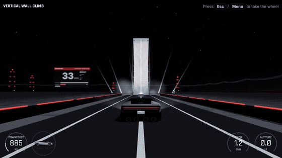
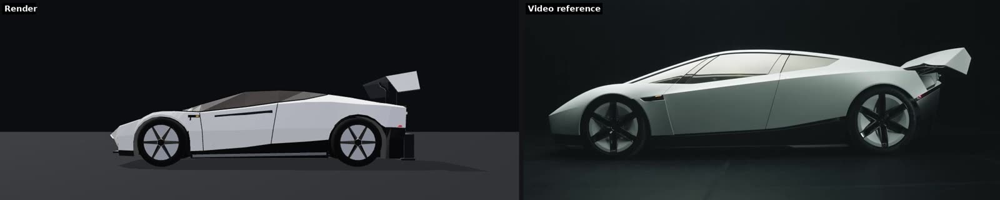
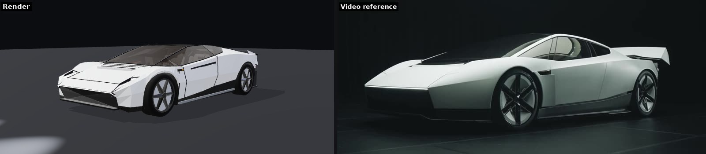
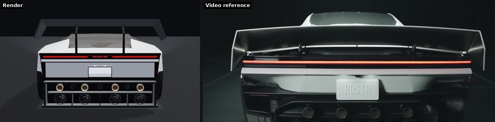
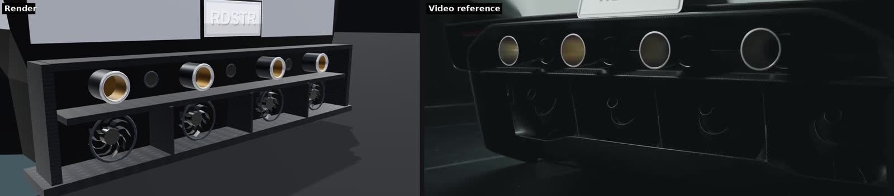
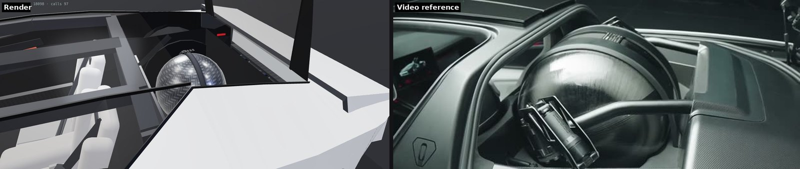
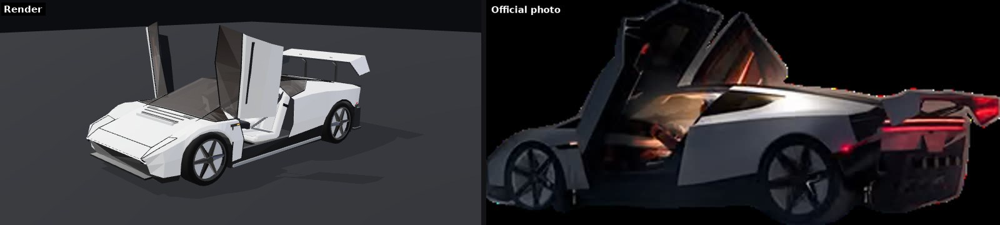
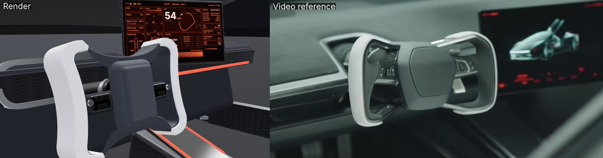
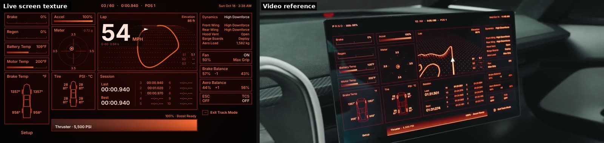
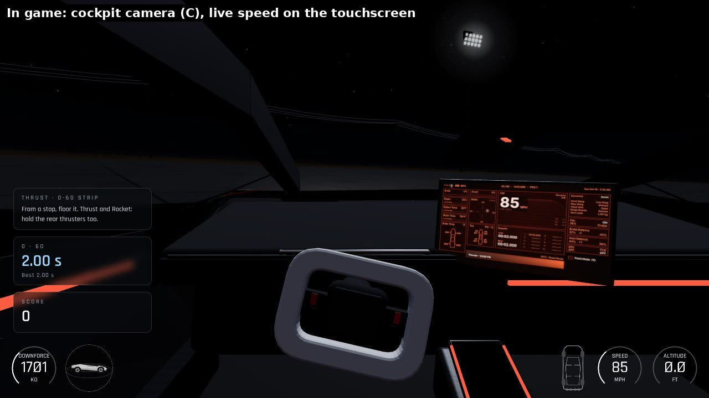

# Roadster and Beyond

A fan-made browser recreation of the Tesla Roadster launch night (15 October 2026, US time, at SpaceX's McGregor, Texas test site). Drive the three versions of the car, or sit back and watch the four highlight stunts replayed in Event mode with a broadcast-style overlay. Built with three.js and Vite. Playable with a keyboard or a gamepad.



*Event mode, recorded frame by frame. The car is on autopilot, but it uses the same physics and controls as a player. [Full MP4](docs/demo.mp4). Re-record it with [tools/demo](tools/demo).*

This is an unofficial tribute. It is not affiliated with or endorsed by Tesla or SpaceX, uses no Tesla assets or logos, and draws everything procedurally in code.

## Model vs. reference

Each image puts the in-game render (left) beside a frame from the closer-look video or an official photo (right). Reference frames are shown for comparison only and belong to their owners.

| | |
|---|---|
|  |  |
| Side profile, wing raised | Front three-quarter, pop-up lamps |
|  |  |
| Tail bar under braking, wing up | Diffuser with cold-gas nozzles and suction fans |
|  |  |
| Rear trunk lid open on the gas tank behind the seats (`K`) | Butterfly doors and wing up |
|  |  |
| Yoke and floating touchscreen | Live track-mode touchscreen |



*First-person camera (`C`): live speed and telemetry on the touchscreen.*

## Play

```bash
npm install
npm run dev      # http://localhost:5173
npm run build    # static site in dist/
```

Pushing to `main` deploys to GitHub Pages through `.github/workflows/deploy.yml`. Add `?event` to the URL to start straight into Event mode.

## What is in it

**The car**, modelled from Tesla's official photos and the close-look video: a low faceted wedge in satin white with a black lower body and silver sill blades, a bronze glass canopy from the windshield to the tail, a raked black nose under a full-width light line, pop-up lamps that lift out of the hood seams, a hood vent, a rear trunk lid behind the cabin that swings up over the carbon-wrapped gas sphere, amber markers over the outlets behind the front wheels, butterfly doors, a deck wing that rises up and back on swan-neck struts and tilts into an airbrake, a full-width red tail bar with lit lettering over a lit RDSTR plate, four gold-lined cold-gas nozzles over four suction-fan bays in a carbon diffuser, and six-spoke wheels on aero discs. Inside: white buckets with lit badges, belts, a dark alcantara dash with carbon trim and a red ambient strip, the squared yoke (it turns with the steering), a console tray, the roll hoop, and the floating touchscreen, which in the cockpit camera shows live telemetry in the car's Track Mode layout (speed, gear, battery, brake/accel/regen, temperatures, g-meter, lap trace, tyres, 0-60 session and thruster gas).

**Three versions**, as announced:

| | Performance | Thrust | Rocket |
| --- | --- | --- | --- |
| Suction fans | yes | yes | yes |
| Cold-gas nozzles | none | 4 rear | 10: 4 rear, 4 lift (one behind each wheel), 2 nose |
| Seats | 2 | 2 | 1 |
| 0-60 mph in the game | 1.52 s | 0.84 s | 0.58 s |
| Tesla's claim | under 1.6 s | under 0.9 s | under 0.6 s |

**The physics** is a real rigid body, not an arcade model. The car has mass and inertia; four raycast wheels with springs, dampers and a slip-angle tyre model (about 1.26 g of grip on their own); fans that pull the car onto whatever surface it is on, up to 4,700 kg (the figure the broadcast's downforce gauge peaked at); aero drag and wing downforce; and every cold-gas nozzle as a separate force at its real position. The Rocket has a flight computer: stick input commands roll, pitch and yaw rates and, while hovering, holds the attitude you left it at. Turn on flight assist and it also levels itself when you let go and leans against drift like a drone (Event mode always flies with assist). It ignores a wheel briefly leaving the road over a bump, so it never fights your steering on the ground. This is what lets the car climb past vertical and hang upside down, and why a flip only works if you have the thrust and the height for it.

**The four stunts**, in the order and with the captions of the broadcast highlights:

1. **Vertical wall climb / holding upside down.** A tall, narrow ramp that curls over to 170°, about 68 ft up. Suction holds the car on the ceiling; it then reverses back down.
2. **Flight off the ramp.** Up the same ramp and off the lip. The flight computer rolls it upright and the four lift jets hover it down into a cloud of smoke.
3. **Kickflip over the lineup.** A thruster hop and a full roll over a Model 3, Model Y, Cybertruck, Cybercab and Semi parked side by side. Replayed in slow motion.
4. **Vertical jump & flip.** From a standstill: lift, backflip, hover down, in front of the red pillar and the light fans. Replayed in slow motion.

Event mode closes with a 0-60 run on the drag strip (the event's timed run was 0.81 s).

**The broadcast overlay**, after the stream's: an arc gauge for downforce (kg) or G-force, a globe with the car inside showing its attitude, pitch in degrees, altitude in feet, and a top-down diagram that lights each nozzle as it fires. Free driving adds speed, a 0-60 timer and a score for flips, rolls, air time, clearing the lineup and the wall hang.

## Controls

| Action | Keyboard | Gamepad |
| --- | --- | --- |
| Throttle / brake (hold brake at a stop to reverse) | `W` `S` | `RT` / `LT` |
| Steer | `A` `D` | Left stick |
| Rear thrusters | `Shift` (Thrust: also `Space`) | `RB` (Thrust: also `A`) |
| Rocket: hop, hold to hover | `Space` | `A` |
| Rocket hovering: climb / descend | `W` / `S` | `RT` / `LT` |
| Rocket in the air: pitch, roll | `W` `S`, `A` `D` | Left stick |
| Rocket in the air: yaw | `Q` `E` | Right stick |
| Track Mode (lower, stiffer, wing up, more suction) | `T` | `X` |
| Fans off (drop from the wall) | `F` | `LB` |
| Handbrake | `B` | `B` |
| Camera (chase, far, cockpit, broadcast) | `C` | `Y` |
| Look around | | Right stick |
| Headlights / doors | `L` / `O` | D-pad up / down |
| Trunk (gas sphere) | `K` | |
| Jump to a stunt | `1`-`5` | D-pad left / right |
| Respawn | `R` | View |
| Menu / pause / leave Event mode | `Esc` | Menu |
| Flight assist (auto-level) on/off | `G` | `RS` click |
| Hide help / mute | `H` / `M` | `LS` click |

Controller details: radial stick deadzones with a rescaled live zone, response curves on steering and flight inputs, trigger deadzones, speed-sensitive steering, and continuous rumble from thrust, suction and tyre slip. Pads that support trigger rumble get brake load on the left trigger and traction limit on the right. The menu works fully from the controller.

Tips: take the wall at about 35 mph and keep a little throttle on; brake near the top to hang, then reverse down or press fans-off to drop. For the lineup, hop with the Rocket about 30 m before the cars at 40 mph and roll the stick.

## Sources, and what is inferred

- **Tesla's official Roadster photos and reservation page** (tesla.com/roadster): body, glass, nose, tail, wheels, doors, wing and interior.
- **The broadcast highlights clip** of all four stunts: stunt order and captions, the wall ramp's shape and height (pitch 170°, altitude about 68 ft), the 4,700 kg downforce reading, the overlay design, the four downward lift jets and the smoke on landing, the lineup and the flip stage.
- **Press coverage** of the event for trims, the 0.81 s run, 0-60 claims, nozzle counts and the 600 L / 250 kg air load: [Fox Business](https://www.foxbusiness.com/technology/teslas-new-roadster-makes-flying-debut-hitting-60-mph-under-second), [Engadget](https://www.engadget.com/2287518/tesla-roadster-launch-live-blog/), [ExplainX](https://www.explainx.ai/blog/tesla-roadster-event-recap-everything-announced-not-announced-october-15-2026).

Inferred or invented: exact surfacing (the model is low-poly), nozzle placement on the body, all physics constants beyond the quoted figures (tuned to land on the claimed 0-60 times), the ramp's exact curve (modelled as a circle), the venue layout, a slow gas top-up between runs, and the scoring.

## Project layout

```
src/spec.js     car dimensions, wheels, nozzles, collision hull and the three versions
src/track.js    venue layout shared by physics and rendering
src/physics.js  rigid-body car: suspension, tyres, suction, aero, thrusters, flight computer
src/car.js      procedural Roadster model and its animation
src/world.js    night venue: wall ramp, lineup, flip stage, drag strip, lights, crowd
src/hud.js      broadcast overlay: gauges, attitude globe, thruster map
src/event.js    Event mode: autopilot scripts, cameras, captions, replays
src/input.js    keyboard and Gamepad API
src/fx.js       particles (cold gas, smoke, tyre smoke)
src/audio.js    synthesised sound
src/main.js     menu, scoring, cameras, game loop
preview/        standalone pages for checking the car and the venue
```
